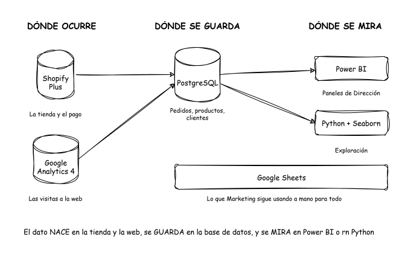

# Arquitectura y Linaje de Datos

## 1. De dónde salen los datos (Origen)
El ecosistema de datos del e-commerce se alimenta de tres fuentes principales según la etapa de interacción:
* **Shopify Plus:** Captura la actividad transaccional de la tienda en línea, pasarelas de pago, catálogo de productos, registros de clientes y devoluciones.
* **Google Analytics 4 (GA4):** Registra el comportamiento de navegación, sesiones y visitas en el sitio web.
* **Google Sheets (Marketing):** Hojas de cálculo operativas gestionadas manualmente por el equipo comercial para el control de campañas y presupuestos.

## 2. Cómo llegan al proyecto (Ingesta en CSV)
Aunque en el entorno productivo los datos operativos y web se centralizan en una base de datos **PostgreSQL** (desde donde se alimentan los paneles ejecutivos de **Power BI**), para garantizar la portabilidad y reproducibilidad de este repositorio, los datos se distribuyen mediante **extractos estáticos en formato `.csv`**.

Estos archivos representan cortes históricos exportados desde las fuentes originales y se alojan localmente en `datos/raw/`, funcionando como punto de partida estándar para cualquier flujo de trabajo requerido en el proyecto:
* **SQL:** Carga en bases de datos relacionales o analíticas para limpieza, consultas y modelado dimensional (esquema estrella).
* **Python:** Ingesta mediante scripts o notebooks para análisis exploratorio (EDA), transformaciones y modelado estadístico.
* **Power BI:** Conexión directa o sobre el modelo ya estructurado para la creación de dashboards interactivos.

## 3. Qué tablas hay (Esquema de datos)
El modelo de datos se compone de 7 tablas principales divididas por dominio de negocio:

| Tabla (Archivo CSV) | Fuente de origen | Descripción y granularidad |
| :--- | :--- | :--- |
| **`pedidos.csv`** | PostgreSQL (`orders`) | Cabecera de las órdenes (1 fila por pedido). Contiene ID de orden, fecha, cliente, estado y totales. |
| **`lineas_pedido.csv`** | PostgreSQL (`order_items`) | Detalle transaccional (1 fila por producto en cada orden). Incluye SKU, cantidad, precio unitario y descuentos. |
| **`devoluciones.csv`** | PostgreSQL (`returns`) | Registro postventa de reembolsos, cancelaciones y motivos asociados a un pedido. |
| **`clientes.csv`** | PostgreSQL (`customers`) | Maestro de clientes (1 fila por usuario) con ubicación geográfica y fecha de registro. |
| **`productos.csv`** | PostgreSQL (`products`) | Catálogo maestro de artículos, categorías, precios de lista y costos unitarios. |
| **`trafico_web.csv`** | Google Analytics 4 | Métricas agregadas de sesiones, canales de adquisición y visitas a la web. |
| **`campana.csv`** | Google Sheets | Registro manual de campañas de marketing, fechas de vigencia, canales, presupuestos y ventas base. |
