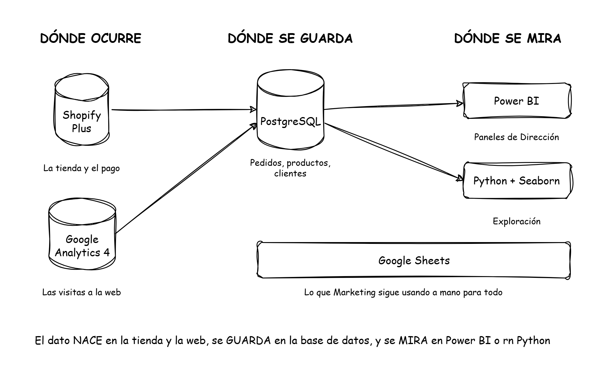

# Diagramas de Arquitectura y Linaje

## 1. Flujo de Datos General

**Descripción del flujo:**

- **Dónde ocurre (Origen):** La interacción del usuario se captura en Shopify Plus (tienda/pagos) y Google Analytics 4 (visitas web).

- **Dónde se guarda (Almacenamiento):** Los datos se centralizan y consolidan en una base de datos PostgreSQL (pedidos, producto, clientes).

- **Dónde se mira (Consumo):**
    - *Power BI:* Para paneles de dirección (KPIs de negocio).
    - *Python + Seaborn:* Para análisis exploratorio y validación.
    - *Google Sheets:* Uso manual residual por parte de Marketing.

**Herramienta de creación:** Boceto conceptual creado en *draw.io* (estilo hand-drawn) exportado a PNG.
