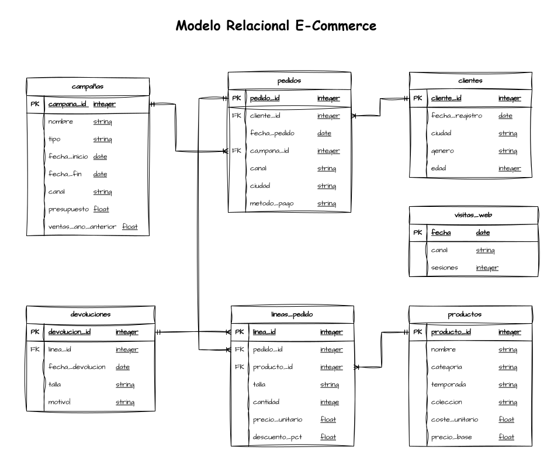

## 2. Modelo Relacional

El siguiente diagrama muestra la estructura de la base de datos (Modelo Entidad-Relación), detallando las claves primarias (PK), claves foráneas (FK) y los tipos de datos de cada campo.

### Descripción General del Modelo
El modelo está diseñado bajo un esquema relacional normalizado para e-commerce, dividiendo la información en tres grupos funcionales:
1. **Tablas Maestras (Dimensiones):** `clientes`, `productos` y `campanas`. Contienen los atributos descriptivos y únicos de cada entidad.
2. **Tablas Transaccionales (Hechos):** `pedidos`, `lineas_pedido` y `devoluciones`. Registran los eventos de compra, el detalle de artículos y la postventa.
3. **Tabla de Analítica Web:** `visitas_web`. Tabla independiente (sin claves foráneas físicas) que almacena sesiones diarias agregadas por canal provenientes de Google Analytics 4.

### Relaciones Principales (Foreign Keys)
* `pedidos.cliente_id` ➔ `clientes.cliente_id`
* `pedidos.campana_id` ➔ `campanas.campana_id`
* `lineas_pedido.pedido_id` ➔ `pedidos.pedido_id`
* `lineas_pedido.producto_id` ➔ `productos.producto_id`
* `devoluciones.linea_id` ➔ `lineas_pedido.linea_id`

### Notas Técnicas del Modelo
* **Granularidad de `devoluciones`:** Depende directamente de `lineas_pedido` (`linea_id`) y no de la cabecera `pedidos`. Esto permite rastrear devoluciones parciales con precisión (por ejemplo, si un cliente compra 3 prendas en una orden y devuelve solo 1 talla).
* **Cruce lógico con `visitas_web`:** Al tratarse de datos agregados a nivel diario por canal (clave primaria compuesta `fecha` + `canal`), se relaciona lógicamente con `pedidos` mediante `fecha_pedido` y `canal` para calcular tasas de conversión sin duplicar registros transaccionales.
